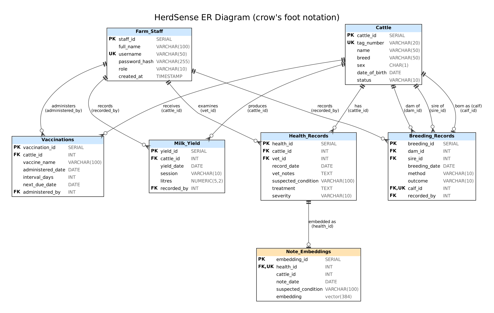

# HerdSense: Livestock Health & Breeding Record Management for Dairy Farms

**Project Report** · DBMS Experiential Learning – Level 3 · PES University, Department of Computer Science and Engineering · Aug–Dec 2026

| Member | SRN | Responsibilities |
|--------|-----|------------------|
| Vaibhav Raj Warrier | PES1UG24CS640 | Cattle, breeding and pedigree, milk yield: tables, queries, triggers, procedures, API routes and pages |
| Varun Rao | PES1UG24CS520 | Staff, health records, vaccinations, vector search, authentication and roles: tables, queries, triggers, procedures, API routes and pages |

Repository: https://github.com/vaibh1409/DBMS-Mini-Project

## Contents

1. Objectives
2. Functional requirements
3. ER diagram
4. Relational schema
5. Database choice and justification
6. Data dictionary

---

## 1. Objectives

Small and mid-sized dairy farms keep cattle records in notebooks or spreadsheets. Health, vaccination, breeding and milk records end up in different places, so problems are noticed late: a vaccination is missed, a cow's milk drops for days before anyone connects it to an illness, or the same animals are bred together without anyone checking their ancestry.

HerdSense brings these records into one database with a web application, and uses the database itself to catch these problems. Its objectives are:

1. **Keep every record of an animal consistent.** Cattle, breeding, health, vaccination and milk records are linked by keys and checked by constraints and triggers, so impossible data (a male animal being milked, a calf born before its parents were bred, a farmhand recorded as the vet) is refused by the database.
2. **Trace pedigrees across generations** with recursive SQL over breeding records, so the farm can see an animal's parents, grandparents and great-grandparents.
3. **Flag what needs attention today:** vaccinations due or overdue (due dates kept by a trigger) and cows whose milk yield has dropped well below their own recent average (a stored function).
4. **Find similar past cases from free-text vet notes.** Notes are embedded as vectors (pgvector), so a vet can describe symptoms in their own words and see past cases with similar meaning and the conditions they turned out to be, even when no words match.
5. **Give each kind of farm worker only the access they need.** Owner, Vet and Farmhand accounts sign in to the web app, and the database's own roles and GRANTs decide what each may read or change.

## 2. Functional Requirements

### Users and roles

| Role | Who | Can do |
|------|-----|--------|
| Owner | Farm owner or manager | Everything: manage the herd, record breedings and calvings, record milk, view and manage health records and vaccinations |
| Vet | Veterinarian | Examine animals (add, edit, delete health records), vaccinate, search similar cases; read cattle, breeding and milk records |
| Farmhand | Farm worker | Record milk yield; read the herd list and milk records |

### Requirements

| ID | Requirement | Roles |
|----|-------------|-------|
| FR1 | Sign in with a username and password; sign out. Sessions expire after 8 hours | all |
| FR2 | Show each user only the pages and actions their role allows; refuse other requests in the API and in the database | all |
| FR3 | Show a "Today" dashboard: milk drops, vaccinations due or overdue, milk readings not yet recorded today | all (milk drops and vaccinations: Owner, Vet) |
| FR4 | List the herd with search (tag or name) and filters (status, sex, breed) | all |
| FR5 | Add, edit and delete an animal; refuse a duplicate tag and refuse deleting an animal that is a parent in breeding records | Owner |
| FR6 | Show an animal's page: details, 14-day milk chart, parents and calves, pedigree chart, health history | all (pedigree and health: Owner, Vet) |
| FR7 | Record a breeding (dam, sire, date, natural or AI); check the dam is female and the sire male | Owner |
| FR8 | Record a calving: add the calf and close the breeding record in one transaction | Owner |
| FR9 | Record morning and evening milk readings; refuse a second reading for the same cow, date and session, and readings for male or inactive animals | Owner, Farmhand |
| FR10 | Show daily milk totals and flag cows whose yield dropped more than 20% below their own average | all (drops: Owner, Vet) |
| FR11 | Add, edit and delete examinations (vet notes, suspected condition, treatment, severity); only a Vet can be recorded as the examining vet | Vet (Owner can view, edit, delete) |
| FR12 | Search past vet notes by meaning (vector similarity), by exact words (full-text search) or both side by side; suggest likely conditions from the closest cases | Owner, Vet |
| FR13 | Show, remove and re-create a note's vector; editing a note re-embeds it; deleting a record deletes its vector | Owner, Vet |
| FR14 | Show vaccinations due, overdue or upcoming; vaccinate several animals at once in one transaction; keep each dose's next due date automatically | Vet (Owner can view) |
| FR15 | Validate all input in the database (keys, CHECK, UNIQUE, NOT NULL, triggers) and show the database's message in the interface | all |

### Non-functional requirements

- Database credentials and the session secret come from environment variables (`.env`), never from the source code.
- Passwords are stored as bcrypt hashes; all SQL uses parameters.
- The interface works at laptop and phone widths.

## 3. ER Diagram

The diagram uses crow's foot notation. Seven entities: six relational (`Farm_Staff`, `Cattle`, `Breeding_Records`, `Health_Records`, `Vaccinations`, `Milk_Yield`) and one vector entity (`Note_Embeddings`, shaded).

Key points of the design:

- **Cattle is related to Breeding_Records three times:** as the dam (mother), the sire (father) and the calf. This recursive parent–offspring relationship is what the pedigree queries walk through. Each calf comes from at most one breeding record (`calf_id` is UNIQUE).
- **Farm_Staff** records breedings and milk readings and, as a Vet, examines animals and gives vaccines.
- **Health_Records to Note_Embeddings is one to zero-or-one:** each vet note has at most one vector.

Source files: `docs/design/er_diagram.dot` (Graphviz), `er_diagram.png`, `er_diagram.svg`.

## 4. Relational Schema

PK = primary key, FK = foreign key, UK = unique key.

- **Farm_Staff**(<u>staff_id</u>, full_name, username (UK), password_hash, role, created_at)
- **Cattle**(<u>cattle_id</u>, tag_number (UK), name, breed, sex, date_of_birth, status)
- **Breeding_Records**(<u>breeding_id</u>, dam_id (FK → Cattle), sire_id (FK → Cattle), breeding_date, method, outcome, calf_id (FK → Cattle, UK), recorded_by (FK → Farm_Staff))
- **Health_Records**(<u>health_id</u>, cattle_id (FK → Cattle), vet_id (FK → Farm_Staff), record_date, vet_notes, suspected_condition, treatment, severity)
- **Vaccinations**(<u>vaccination_id</u>, cattle_id (FK → Cattle), vaccine_name, administered_date, interval_days, next_due_date, administered_by (FK → Farm_Staff))
- **Milk_Yield**(<u>yield_id</u>, cattle_id (FK → Cattle), yield_date, session, litres, recorded_by (FK → Farm_Staff)), UK (cattle_id, yield_date, session)
- **Note_Embeddings**(<u>embedding_id</u>, health_id (FK → Health_Records, UK), cattle_id, note_date, suspected_condition, embedding vector(384))

### Foreign keys and delete rules

| Table | Column | References | ON DELETE | Why |
|---|---|---|---|---|
| Breeding_Records | dam_id, sire_id, calf_id | Cattle | RESTRICT | A parent or calf in the pedigree cannot disappear |
| Breeding_Records | recorded_by | Farm_Staff | RESTRICT | Keeps who recorded it |
| Health_Records | cattle_id | Cattle | CASCADE | An animal's records go with it |
| Health_Records | vet_id | Farm_Staff | RESTRICT | Keeps the examining vet |
| Vaccinations | cattle_id | Cattle | CASCADE | As above |
| Vaccinations | administered_by | Farm_Staff | RESTRICT | Keeps who vaccinated |
| Milk_Yield | cattle_id | Cattle | CASCADE | As above |
| Milk_Yield | recorded_by | Farm_Staff | RESTRICT | Keeps who recorded it |
| Note_Embeddings | health_id | Health_Records | CASCADE | A note's vector is deleted with the note |

### Relationships

| Parent | Child | Relationship | Cardinality |
|---|---|---|---|
| Farm_Staff | Health_Records | examines | 1 : N |
| Farm_Staff | Vaccinations | administers | 1 : N |
| Farm_Staff | Milk_Yield | records | 1 : N |
| Farm_Staff | Breeding_Records | records | 1 : N |
| Cattle | Health_Records | has | 1 : N |
| Cattle | Vaccinations | receives | 1 : N |
| Cattle | Milk_Yield | produces | 1 : N |
| Cattle | Breeding_Records | dam of / sire of | 1 : N each |
| Cattle | Breeding_Records | born as (calf) | 1 : 0..1 |
| Health_Records | Note_Embeddings | embedded as | 1 : 0..1 |

### Constraints

| Kind | Where |
|---|---|
| NOT NULL | Every required column, for example `Cattle.breed`, `Health_Records.vet_notes`, `Milk_Yield.litres` |
| UNIQUE | `Farm_Staff.username`, `Cattle.tag_number`, `Breeding_Records.calf_id`, `Note_Embeddings.health_id`, `Milk_Yield (cattle_id, yield_date, session)` |
| CHECK (value lists) | `role IN ('Owner','Vet','Farmhand')`, `sex IN ('F','M')`, `status IN ('Active','Sold','Deceased')`, `method IN ('Natural','AI')`, `outcome IN ('Pending','Calved','Failed')`, `severity IN ('Mild','Moderate','Severe')`, `session IN ('Morning','Evening')` |
| CHECK (values) | Dates not in the future; `litres >= 0`; `interval_days > 0`; notes not blank |
| CHECK (across columns) | `dam_id <> sire_id`; a calf is not its own parent; `(outcome = 'Calved') = (calf_id IS NOT NULL)` |
| DEFAULT | `status 'Active'`, `outcome 'Pending'`, `created_at now()` |
| Triggers (rules that need another table) | Dam female and sire male, calf born after the breeding, milk only for active females, only a Vet examines or vaccinates |

The full column-by-column list is in `docs/design/relational_schema.md`.

### Normalisation

Every table has a single-column surrogate primary key and every non-key column depends only on that key, so the tables are in third normal form. For example, an animal's breed is stored once in `Cattle`, not repeated on each milk reading. Two values are stored on purpose although they can be derived:

- `Vaccinations.next_due_date` (= administered date + interval) is kept so due vaccinations can be found with an index; a trigger always recalculates it, so it cannot become wrong.
- `Note_Embeddings` copies `cattle_id`, `note_date` and `suspected_condition` from the health record as metadata, so vector search can filter without a join; a trigger keeps them in step.

## 5. Database Choice and Justification

| Data | Nature | Database | Why |
|---|---|---|---|
| Cattle, staff, breeding, health records, vaccinations, milk yield | Structured, related, must stay consistent | **PostgreSQL (SQL)** | Keys, constraints and ON DELETE rules keep animals, parents, staff and records consistent; recursive CTEs trace pedigrees; triggers and procedures enforce farm rules; transactions make multi-step changes all-or-nothing; roles and GRANTs give database-level access control; joins and aggregates produce reports |
| Free-text vet notes | Unstructured text, searched by meaning | **Vector database (pgvector)** | Two notes can describe the same condition in different words ("swollen udder, clots in milk" and "hard quarter, abnormal secretion"). Keyword search misses this; embeddings compared by cosine similarity find it |

### Why pgvector rather than a separate vector database

- **One database, one transaction:** the vector is saved, updated and deleted in the same transaction as the note it describes, and a foreign key with ON DELETE CASCADE keeps them consistent. With a separate vector store, extra code would have to keep the two in sync and could fail halfway.
- **Same access control:** the vector table is protected by the same database roles as the health records.
- **Enough scale:** a farm has thousands of notes, not millions. An HNSW index inside PostgreSQL answers nearest-neighbour queries quickly at this size.
- **Trade-off:** a dedicated vector database such as Qdrant or Pinecone scales further and has more specialised features, which this project does not need.

### Why not a document (NoSQL) database

The data is highly relational (animals, their parents, staff and records about them) and relies on joins, constraints and transactions. A document database would give up those guarantees without a matching benefit.

## 6. Data Dictionary

Seven tables: six relational tables and one vector table (`Note_Embeddings`, pgvector).

### Farm_Staff

Farm users who log in and record data. The role decides what each user may do.

| Column | Type | Key | Null | Constraints | Description |
|---|---|---|---|---|---|
| staff_id | SERIAL | PK | No | - | Unique staff identifier |
| full_name | VARCHAR(100) | - | No | - | Staff member's full name |
| username | VARCHAR(50) | UK | No | UNIQUE | Login name |
| password_hash | VARCHAR(255) | - | No | - | bcrypt hash of the password (never the plain password) |
| role | VARCHAR(10) | - | No | CHECK (role IN ('Owner','Vet','Farmhand')) | Access role used for role-based access control |
| created_at | TIMESTAMP | - | No | DEFAULT now() | When the account was created |

### Cattle

One row per animal on the farm.

| Column | Type | Key | Null | Constraints | Description |
|---|---|---|---|---|---|
| cattle_id | SERIAL | PK | No | - | Unique animal identifier |
| tag_number | VARCHAR(20) | UK | No | UNIQUE | Ear-tag number printed on the animal |
| name | VARCHAR(50) | - | Yes | - | Optional pet name |
| breed | VARCHAR(50) | - | No | - | Breed of the animal |
| sex | CHAR(1) | - | No | CHECK (sex IN ('F','M')) | F = female, M = male |
| date_of_birth | DATE | - | No | CHECK (date_of_birth <= CURRENT_DATE) | Birth date |
| status | VARCHAR(10) | - | No | DEFAULT 'Active'; CHECK (status IN ('Active','Sold','Deceased')) | Current status on the farm |

### Breeding_Records

One row per breeding event. Dam, sire and calf all point back to Cattle, which makes the parent-offspring lineage a recursive relationship used for pedigree tracing.

| Column | Type | Key | Null | Constraints | Description |
|---|---|---|---|---|---|
| breeding_id | SERIAL | PK | No | - | Unique breeding event identifier |
| dam_id | INT | FK -> Cattle(cattle_id) | No | - | Mother (the cow bred) |
| sire_id | INT | FK -> Cattle(cattle_id) | No | - | Father (the bull or AI sire) |
| breeding_date | DATE | - | No | CHECK (breeding_date <= CURRENT_DATE) | Date of breeding |
| method | VARCHAR(10) | - | No | CHECK (method IN ('Natural','AI')) | Natural mating or artificial insemination |
| outcome | VARCHAR(10) | - | No | DEFAULT 'Pending'; CHECK (outcome IN ('Pending','Calved','Failed')) | Result of the breeding |
| calf_id | INT | FK, UK -> Cattle(cattle_id) | Yes | UNIQUE | The calf born from this breeding, set once calved. UNIQUE because an animal is born only once |
| recorded_by | INT | FK -> Farm_Staff(staff_id) | No | - | Staff member who entered the record |

Table-level rules:
- CHECK (dam_id <> sire_id): an animal cannot be bred with itself
- CHECK (calf_id IS NULL OR (calf_id <> dam_id AND calf_id <> sire_id)): a calf cannot be its own parent
- CHECK ((outcome = 'Calved') = (calf_id IS NOT NULL)): a calf is recorded exactly when the outcome is Calved

### Health_Records

One row per vet examination. The free-text vet_notes are the source of the embeddings stored in Note_Embeddings.

| Column | Type | Key | Null | Constraints | Description |
|---|---|---|---|---|---|
| health_id | SERIAL | PK | No | - | Unique health record identifier |
| cattle_id | INT | FK -> Cattle(cattle_id) | No | - | Animal examined |
| vet_id | INT | FK -> Farm_Staff(staff_id) | No | - | Staff member who examined the animal |
| record_date | DATE | - | No | CHECK (record_date <= CURRENT_DATE) | Date of the examination |
| vet_notes | TEXT | - | No | CHECK (length(trim(vet_notes)) > 0) | Free-text symptom and observation notes |
| suspected_condition | VARCHAR(100) | - | Yes | - | Condition the vet suspects, for example mastitis |
| treatment | TEXT | - | Yes | - | Treatment given or prescribed |
| severity | VARCHAR(10) | - | No | CHECK (severity IN ('Mild','Moderate','Severe')) | How serious the case is |

### Vaccinations

One row per vaccine dose given. A trigger fills next_due_date, and a view lists animals that are due or overdue.

| Column | Type | Key | Null | Constraints | Description |
|---|---|---|---|---|---|
| vaccination_id | SERIAL | PK | No | - | Unique vaccination identifier |
| cattle_id | INT | FK -> Cattle(cattle_id) | No | - | Animal vaccinated |
| vaccine_name | VARCHAR(100) | - | No | - | Name of the vaccine |
| administered_date | DATE | - | No | CHECK (administered_date <= CURRENT_DATE) | Date the dose was given |
| interval_days | INT | - | No | CHECK (interval_days > 0) | Days until the next dose is needed |
| next_due_date | DATE | - | Yes | - | Set by trigger: administered_date + interval_days |
| administered_by | INT | FK -> Farm_Staff(staff_id) | No | - | Staff member who gave the dose |

### Milk_Yield

One row per milking session per animal. Used for yield-anomaly detection.

| Column | Type | Key | Null | Constraints | Description |
|---|---|---|---|---|---|
| yield_id | SERIAL | PK | No | - | Unique yield record identifier |
| cattle_id | INT | FK -> Cattle(cattle_id) | No | - | Animal milked |
| yield_date | DATE | - | No | CHECK (yield_date <= CURRENT_DATE) | Date of milking |
| session | VARCHAR(10) | - | No | CHECK (session IN ('Morning','Evening')) | Milking session |
| litres | NUMERIC(5,2) | - | No | CHECK (litres >= 0) | Milk collected in litres |
| recorded_by | INT | FK -> Farm_Staff(staff_id) | No | - | Staff member who entered the reading |

Table-level rules:
- UNIQUE (cattle_id, yield_date, session): one reading per animal per session

### Note_Embeddings

Vector store (pgvector). One 384-dimension embedding per vet note, plus the metadata used to filter and display results.

| Column | Type | Key | Null | Constraints | Description |
|---|---|---|---|---|---|
| embedding_id | SERIAL | PK | No | - | Unique embedding identifier |
| health_id | INT | FK, UK -> Health_Records(health_id) | No | UNIQUE | Health record whose vet_notes were embedded (one embedding per note) |
| cattle_id | INT | - | No | - | Metadata: animal the note is about |
| note_date | DATE | - | No | - | Metadata: date of the note |
| suspected_condition | VARCHAR(100) | - | Yes | - | Metadata: condition the vet suspected |
| embedding | vector(384) | - | No | - | all-MiniLM-L6-v2 embedding of vet_notes |

The same tables with their constraints and descriptions are kept in `docs/design/data_dictionary.md`.
